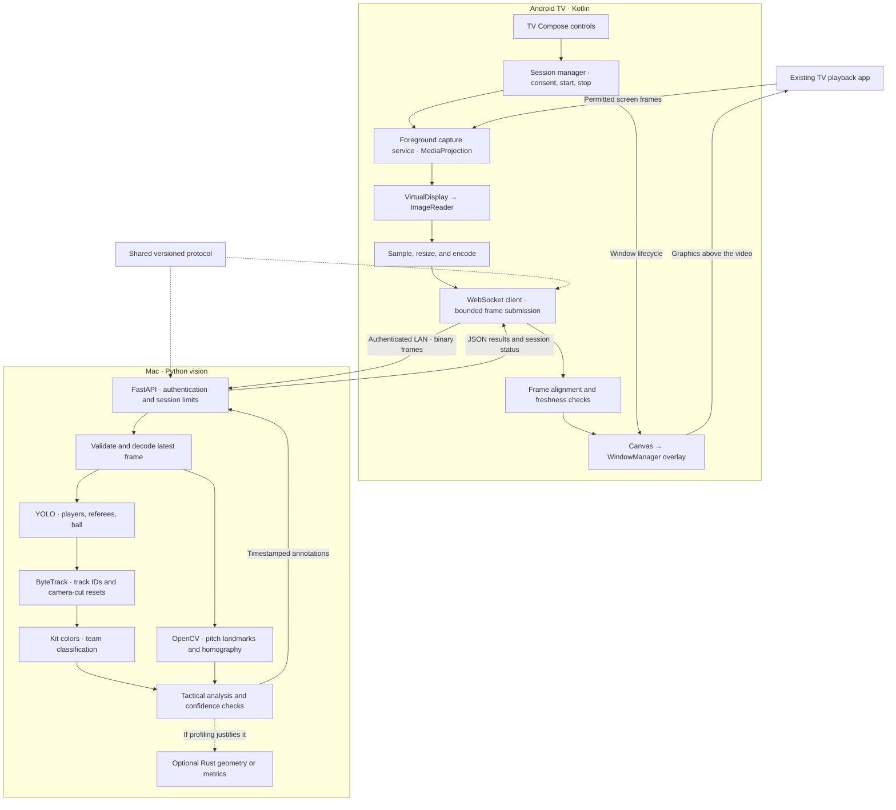

# Football Tactics

Football Tactics is a planned Android TV companion that adds optional tactical graphics over live football in a compatible playback app. The TV handles capture and draws the graphics. A Mac on the same local network analyzes the frames. The first release is for personal use and will be sideloaded.

**Status** · The repository contains architecture notes and a monorepo scaffold. The next milestone is to build the empty Android TV and Python projects. Capture and overlay support on the reference TV still needs to be tested.

## What watching a match looks like

1. Open Football Tactics on the TV, choose the graphics you want, and start an analysis session.
2. Grant Android's capture and overlay permissions, then switch to your usual playback app.
3. Watch the match with your normal remote. The first live graphics will mark players with circles, tracking IDs, and team colors.
4. Return to Football Tactics to change layers or stop the session. Stopping releases the capture resources and clears the overlay.

## Planned architecture

| Module | What it owns |
| --- | --- |
| [Android TV app](docs/architecture/android-tv.md) | D-pad-friendly controls, permission flows, session state, frame capture, and overlay rendering. The renderer maps normalized image coordinates to the TV picture, accounting for scaling and letterboxing. |
| [Python vision app](docs/architecture/vision-pipeline.md) | Frame validation, detection, tracking, team classification, pitch calibration, and tactical calculations. The same vision pipeline will run on recorded footage without FastAPI. |
| [Shared protocol](docs/architecture/realtime-protocol.md) | Versioned message schemas, coordinate conventions, and compatibility fixtures. Results echo the session ID, frame sequence, and TV monotonic capture timestamp so the TV can reject stale results using its own clock. |
| [Rust tactical engine](docs/decisions/0005-rust-optimization.md) | Reserved for geometry and numerical operations where profiling shows a measurable benefit over Python. |
| [Moonrepo workspace](docs/architecture/monorepo.md) | Coordinates development and CI checks across Gradle for Android, `uv` for Python, and Cargo for Rust. |

### From player markers to tactical graphics

Player circles, tracking IDs, and team colors come first. Pitch calibration then maps visible players onto the pitch so the system can estimate defensive lines, team compactness, spacing, and passing lanes. Later layers can add open space, formations, pressing and defensive blocks, movement trails, heatmaps, and approximate offside reference lines. Camera cuts reset tracking, and low confidence or stale results suppress the affected graphics.

### Capture, privacy, and latency

- Android capture consent applies to each session. Some playback apps or devices block capture or hide overlays. Protected content stays protected. The [physical TV experiment](docs/experiments/android-capture-feasibility.md) checks whether capture and overlay work together, whether the overlay appears in captured frames, and whether the remote still controls playback. A required app blocking either capability pauses work for a decision.
- The planned LAN connection authenticates the TV and restricts who can send frames. Payloads, frame rates, and queues are bounded. The pipeline prefers the newest frame, keeps raw video transient by default, and clears annotations when consent is revoked, results become stale, or the connection fails.
- Initial targets are **5–10 captured FPS**, **640–960 px inference input width**, and **30–60 FPS overlay rendering**. The capture-to-overlay target is **under 300 ms**, with an initial ceiling of **under 500 ms**. These are targets for measurement on the reference TV and Mac.

## Build and verification plan

| Milestone | What it verifies |
| --- | --- |
| Empty Android and Python projects | The blank TV app builds and launches. The Python package installs from a lockfile and passes its setup checks. |
| Physical TV feasibility | On the owner's TV, an authorized unprotected clip in a separate playback app remains capturable while the overlay is visible and the D-pad still works. Verify permission denial, stop, revocation, and resource cleanup. |
| Offline vision evaluation | Licensed recorded clips produce reviewable annotations and a baseline for detection, tracking, and latency. |
| Live TV-to-Mac integration | Authenticated frame submission returns fresh player graphics that align with the picture. Verify bounded queues, stale-result rejection, and recovery from disconnects. |
| Tactical layers and release readiness | Evaluate pitch calibration and new layers. Verify reproducible builds, reliable start and stop, bounded resource use in long sessions, and measured end-to-end latency on the reference setup. |

[Project requirements](docs/requirements.md) · [Architecture overview](docs/architecture/system-overview.md) · [Implementation plan](docs/roadmap/implementation-plan.md) · [Engineering guidance](AGENTS.md)
