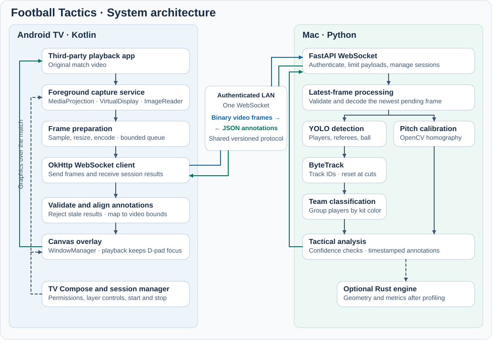

# Football Tactics

Football Tactics brings tactical analysis to live football on Android TV. Watch the match in a compatible playback app and choose which graphics appear over the picture. The TV captures authorized frames and draws the overlay. A Mac on the same local network runs the computer vision and tactical analysis. The system is designed for personal use with a sideloaded TV app.

## Watching a match

1. Open Football Tactics on the TV, select the visualization layers, and start an analysis session.
2. Grant Android's capture and overlay permissions, then switch to a compatible playback app.
3. Watch with your normal remote. The overlay draws over the match while playback keeps D-pad focus.
4. Return to Football Tactics to change layers or stop the session. Capture ends, resources are released, and the overlay clears.

| Visualization | What appears over the match |
| --- | --- |
| Players and teams | Player circles, tracking IDs, and team colors. |
| Team shape | Defensive lines, formations, pressing structure, and defensive blocks. |
| Spacing and movement | Team compactness, distances between players, movement trails, and space occupation heatmaps. |
| Tactical estimates | Passing lanes, open space, and approximate offside reference lines. |

## System architecture

| Module | Responsibilities |
| --- | --- |
| Android TV app · Kotlin | TV Compose provides remote-friendly controls. A session manager coordinates consent, connection, capture, and teardown. The foreground capture service reads frames through MediaProjection, VirtualDisplay, and ImageReader. OkHttp handles transport. A non-focusable Canvas overlay uses WindowManager to draw annotations. |
| Vision service · Python | FastAPI manages authenticated sessions and validates inputs with Pydantic. The vision pipeline decodes and preprocesses frames, detects players, referees, and the ball with PyTorch and YOLO, tracks players with ByteTrack, and estimates team membership from kit colors. OpenCV uses pitch landmarks and homography to map image positions to the pitch. Tactical analysis combines these outputs into timestamped annotations. The pipeline also supports offline evaluation on recorded footage. |
| Shared protocol | A versioned WebSocket carries compressed frames as binary and annotations, calibration, session state, errors, and heartbeats as JSON. The contract defines message schemas, coordinates, and compatibility fixtures. Session IDs, frame sequences, and TV monotonic timestamps let the client correlate results and measure their age on the same clock. |
| Rust tactical engine | An optional Cargo component for measured bottlenecks in geometry, interpolation, spatial indexing, or tactical metrics. Python owns the baseline calculations. Profiling determines which operations move to Rust. |
| Moonrepo workspace | Coordinates Gradle Kotlin DSL for Android, `uv` for Python, and Cargo for Rust. GitHub Actions runs builds, language checks, unit tests, and protocol validation. Hardware checks and vision evaluation run separately. |

### Frame handling and overlay alignment

The TV samples, resizes, and encodes permitted frames before sending them over the LAN. Bounded queues favor the newest frame when inference falls behind. The TV maps normalized image coordinates to the visible video bounds, accounting for scaling, letterboxing, and pillarboxing.

Tracking resets at camera cuts and calibration updates as the camera moves. Stale results, replay transitions, and low-confidence geometry suppress affected graphics. A disconnect clears the overlay and reconnection starts a fresh analysis session.

### Compatibility and privacy

Capture and overlay support depend on the TV, playback app, and content. The system uses public Android APIs and respects DRM, HDCP, secure windows, and app-level overlay restrictions. Each session requires explicit capture consent, a visible capture indicator, and an accessible stop control. Consent revocation ends capture and clears the overlay.

The LAN connection authenticates clients and enforces payload, rate, and resource limits. Raw frames are transient by default, and logs omit video contents and credentials.

### Performance and verification

| Metric | Engineering target |
| --- | --- |
| Capture rate | 5–10 FPS |
| Inference input width | 640–960 px |
| Overlay rendering | 30–60 FPS |
| Capture-to-overlay latency | Under 300 ms target, under 500 ms ceiling |
| Resource use | Bounded frame queues and measured memory on the TV and Mac |

Release verification covers reproducible builds, deterministic replay, and long sessions on the reference TV and Mac. Physical-device checks cover simultaneous capture and overlay, D-pad navigation, permission denial and revocation, protected playback, and teardown. Replay and integration checks cover frame correlation, backpressure, reconnects, alignment, and detection, tracking, and calibration quality. End-to-end measurements break down capture, encoding, transport, inference, tactical analysis, and rendering.

## Design references

- [Project requirements](docs/requirements.md) · [System overview](docs/architecture/system-overview.md)
- [Android TV](docs/architecture/android-tv.md) · [Vision pipeline](docs/architecture/vision-pipeline.md) · [Real-time protocol](docs/architecture/realtime-protocol.md)
- [Monorepo](docs/architecture/monorepo.md) · [Rust decision](docs/decisions/0005-rust-optimization.md) · [Physical TV test plan](docs/experiments/android-capture-feasibility.md)
